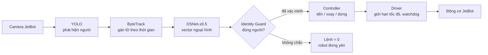
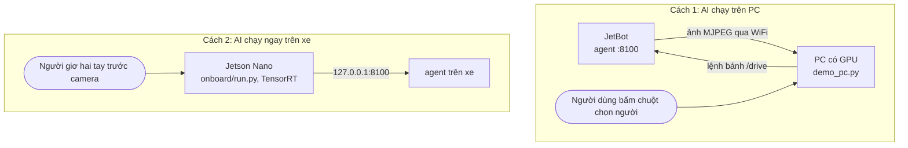
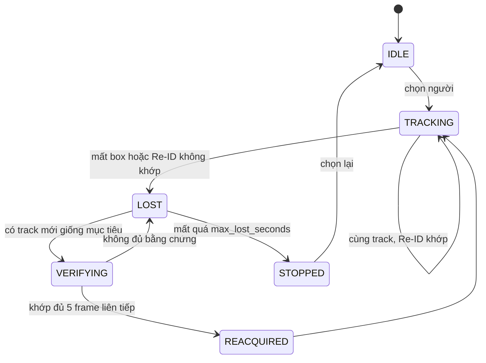
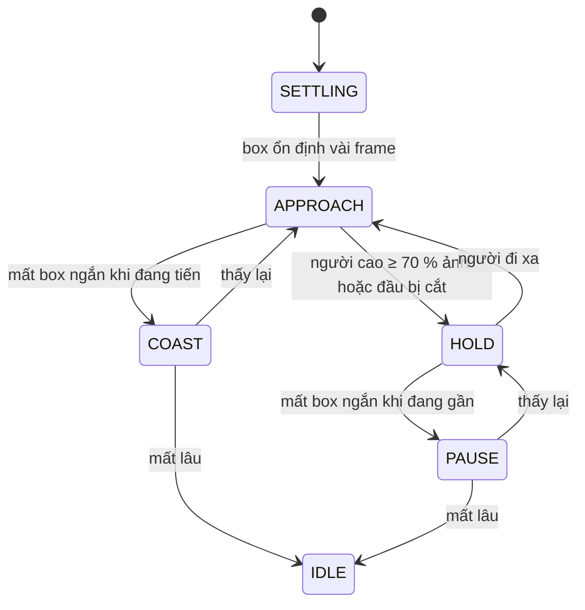

# JetBot bám theo người có nhận dạng lại (Re-ID)

Đồ án môn CS532: robot **NVIDIA JetBot** dùng một camera, bám theo **đúng một người** được chọn, kể cả khi
đông người, có người đi ngang, bị che khuất, người nghiêng mình hay ánh sáng thay đổi.
Robot không đoán: khi không chắc người trong khung là đúng mục tiêu, robot **dừng** (fail-closed).



## Đồ án làm gì

| Bài toán | Cách giải quyết |
|---|---|
| Tìm người trong ảnh | YOLO phát hiện người: YOLO26s trên PC, YOLOv8n-pose trên Nano |
| Giữ ID qua các frame | ByteTrack ghép cả box có điểm thấp, nên ID ít bị đứt |
| Nhận lại đúng người sau khi mất dấu | OSNet so ngoại hình với ảnh mẫu của người đã chọn |
| Không bao giờ chạy theo người khác | Identity Guard chỉ cho phép chạy khi Re-ID xác minh được |
| Chọn người cần bám | Bấm chuột trên PC, hoặc giơ hai tay trước xe |
| Bám êm, không đâm người | Controller theo pha, dừng cách người khoảng 1 m |
| Chạy trên thiết bị thật | TensorRT FP16 trên Jetson Nano, khoảng 14 FPS |
| Sửa thuật toán mà không cần xe | Mô phỏng vòng kín và phát lại video thật |

Ngoài phạm vi: tránh vật cản. Robot chỉ quan tâm người mà nó bám theo.

## Hai cách chạy



| | AI trên PC | AI trên Nano |
|---|---|---|
| Lệnh | `python demo_pc.py --source jetbot --driver jetbot --device cuda:0` | `python3 -m onboard.run` |
| Detector | YOLO26s (PyTorch, GPU) | YOLOv8n-pose 288×480 (TensorRT FP16) |
| Chọn người | Bấm chuột trên màn hình | Giơ hai tay khoảng 0,5 s, rồi xoay một vòng để xe thu ảnh mẫu |
| Cần WiFi | Có | Không |
| Phù hợp | Debug, xem dashboard, ghi log | Demo độc lập |

Ngoài ra repo còn phần **nghiên cứu trên MOT17**: so sánh các phiên bản quản lý danh tính V1–V5.1 bằng MOTA, IDF1, IDSW
(`python main.py ...`).

## Cách robot giữ đúng người

### Identity Guard

`src/following/guarded_lock.py`. Guard giữ các ảnh mẫu (embedding) của người được chọn.
Mỗi frame, Guard quyết định có được phép chạy hay không:



Chỉ `TRACKING` và `REACQUIRED` được phép chạy. Mọi trạng thái khác cho lệnh bằng 0.

Trên xe thật, Guard nới ngưỡng **chỉ cho track đang bám liên tục** (`guard:` trong `configs/jetbot.yaml`).
Track mới vẫn phải qua ngưỡng chặt, nên không thể "nhảy" sang người khác:

| Tùy chọn | Xử lý tình huống |
|---|---|
| `continuity_distance` | Người nghiêng mình, đổi ánh sáng: ngưỡng Re-ID rộng hơn cho track đang bám |
| `auto_views` | Tự thêm tối đa 3 ảnh mẫu khi người xoay; ảnh mới phải khớp ảnh gốc |
| `blind_frames` | Ngược sáng, không lấy được embedding: giữ track tối đa khoảng 0,5 s |
| `drop_part_boxes` | YOLO sinh thêm box nửa người: bỏ box đó, không coi là bị che |

### Controller theo pha

`StagedFollowController` trong `src/following/controller.py`:



- **APPROACH**: tiến và xoay về phía người, giảm tốc khi lại gần.
- **COAST**: mất dấu rất ngắn khi người còn xa. Xe đi thẳng tiếp, không xoay tìm.
- **PAUSE**: mất dấu ngắn khi người ở gần. Xe đứng yên, giữ box cũ.

Driver (`src/following/jetbot_driver.py`) chặn thêm ở tầng thấp:
- lệnh hết hạn sau 0,4 s;
- bánh tối đa 0,50, tăng tốc dần, phanh ngay;
- ảnh cũ quá 0,35 s thì dừng;
- `Q`, `Space` hay Ctrl+C luôn gửi `/stop`.

## Cấu trúc thư mục

```text
Jetbot-project/
├── demo_pc.py                 # AI trên PC: video / webcam / xe thật, bấm chọn người, dashboard, ghi log
├── main.py                    # benchmark MOT17 (V1–V5.1, ablation)
├── configs/
│   ├── jetbot.yaml            # xe thật: IP, stream, driver, Guard, controller, on-board, model PC
│   ├── config.yaml            # thuật toán + benchmark MOT17
│   └── bytetrack_custom.yaml  # tham số ByteTrack
├── src/
│   ├── runtime/               # pipeline YOLO + ByteTrack + OSNet, nguồn ảnh MJPEG, dashboard, overlay
│   ├── reid/                  # OSNet embedder, điểm chất lượng crop, chọn checkpoint
│   ├── identity/              # quản lý danh tính V1–V4, V5 (adaptive fusion), V5.1
│   ├── following/             # Identity Guard, controller, driver HTTP cho JetBot
│   ├── evaluation/            # chỉ số MOT17, target-centric, chấm follow trace
│   └── data/                  # đọc dữ liệu MOT17
├── onboard/                   # chạy trên Jetson Nano (Python 3.6)
│   ├── run.py                 # vòng lặp chính, service jetbot-follow
│   ├── models.py              # engine TensorRT: YOLO pose, OSNet
│   ├── bytetrack.py           # ByteTrack bằng numpy
│   ├── modes.py               # guarded (Re-ID + Guard) và nearest (baseline)
│   ├── selection.py           # chọn người bằng giơ hai tay
│   ├── pose_check.py          # thử giơ tay, xe không chạy
│   ├── check_engines.py       # so engine với ONNX (PARITY OK)
│   └── build_engines.sh       # build engine trên Nano
├── jetbot_agent/              # chạy trên xe: HTTP :8100 (/stream, /drive, /stop, watchdog)
├── scripts/
│   ├── sim_follow.py          # mô phỏng vòng kín: 8 kịch bản × 24 bộ tham số vật lý
│   ├── replay_log.py          # phát lại video thật qua toàn bộ pipeline
│   ├── jetbot_tool.py         # kiểm tra kết nối, hiệu chỉnh bánh
│   ├── export_onboard_models.py  # xuất ONNX + dữ liệu parity cho Nano
│   ├── download_reid_weights.py
│   ├── validate_dataset.py
│   └── evaluate_follow_trace.py
├── tests/                     # pytest, không cần GPU, xe hay dữ liệu
└── docs/
    ├── ONBOARD.md             # hướng dẫn chi tiết chạy trên Nano, debug
    ├── PLAN_CODE.md           # thiết kế phần PC
    └── HUONG_DAN_BAO_CAO.md   # hướng dẫn viết báo cáo, số liệu thực nghiệm
```

Không nằm trong git: `data/` (MOT17), `logs/`, `outputs/`, `models/onboard/` (ONNX, engine), trọng số YOLO.

## Cài đặt nhanh (PC Windows có GPU)

```powershell
python -m venv .venv
.\.venv\Scripts\Activate.ps1
python -m pip install -r requirements.txt -r requirements-reid.txt -r requirements-dev.txt
python scripts/download_reid_weights.py --model osnet_x0_5_msmt17
python -m pytest -q
```

Cài PyTorch bản CUDA hợp với GPU trước. Ultralytics tự tải trọng số YOLO lần đầu chạy.

## Chạy với xe thật (AI trên PC)

1. Bật xe, xem IP trên màn OLED, sửa `robot.host` trong `configs/jetbot.yaml`.
2. `python scripts/jetbot_tool.py check` để kiểm tra kết nối.
3. Nếu service trên xe đang chạy thì dừng nó, để PC và Nano không cùng lái:
   `ssh -t jetbot@<ip> "sudo systemctl stop jetbot-follow"`.
4. `python demo_pc.py --source jetbot --driver jetbot --device cuda:0`. Thiếu `--device cuda:0` thì AI chạy CPU, rất chậm.

| Phím | Tác dụng |
|---|---|
| Chuột trái | chọn người |
| `M` | bật/tắt motor (luôn khởi động ở SAFE) |
| `A` | thêm ảnh mẫu |
| `R` | bỏ chọn |
| `Space` | dừng khẩn |
| `Q` | thoát, gửi `/stop` |

Mỗi lần chạy tự ghi `logs/pc_<giờ>_{robot,trace,dets}.csv` và `_raw.mp4`. Phát lại offline:

```powershell
python scripts/replay_log.py logs/pc_<giờ>
```

## Chạy trên Jetson Nano

Chi tiết ở [`docs/ONBOARD.md`](docs/ONBOARD.md).

```bash
python scripts/export_onboard_models.py   # trên PC: ONNX + parity
sh onboard/build_engines.sh               # trên Nano: TensorRT FP16, khoảng 15–20 phút
python3 -m onboard.check_engines          # phải in PARITY OK
python3 -m onboard.run --dry-run          # thử, motor không bật
python3 -m onboard.run                    # chạy thật
```

## Kiểm thử

```powershell
python -m pytest -q             # unit test
python scripts/sim_follow.py    # mô phỏng: guarded (Re-ID + Guard) so với nearest (không Re-ID)
```

Số liệu thực nghiệm và cách viết báo cáo: [`docs/HUONG_DAN_BAO_CAO.md`](docs/HUONG_DAN_BAO_CAO.md).

## Phần cứng và phần mềm

- NVIDIA JetBot, Jetson Nano 4GB, JetPack 4.5 (TensorRT 7.1, Python 3.6), camera CSI.
- PC: Windows, GPU NVIDIA (đã thử RTX 3050), Python 3, PyTorch, Ultralytics, torchreid.

## Giới hạn

- Re-ID dựa trên ngoại hình. Hai người mặc giống hệt nhau vẫn có thể làm Guard không chắc; khi đó robot dừng thay vì đoán.
- Xe chạy tối đa khoảng 0,29 m/s, chậm hơn người đi bộ.
- Chạy AI trên PC phụ thuộc WiFi; mất kết nối thì xe tự dừng.

## Tham khảo

- [Ultralytics YOLO](https://github.com/ultralytics/ultralytics)
- [ByteTrack](https://github.com/ifzhang/ByteTrack) (Zhang et al., ECCV 2022)
- [OSNet / torchreid](https://github.com/KaiyangZhou/deep-person-reid) (Zhou et al., ICCV 2019)
- [MOT17 / MOTChallenge](https://motchallenge.net/data/MOT17/)
- [NVIDIA JetBot](https://github.com/NVIDIA-AI-IOT/jetbot)
